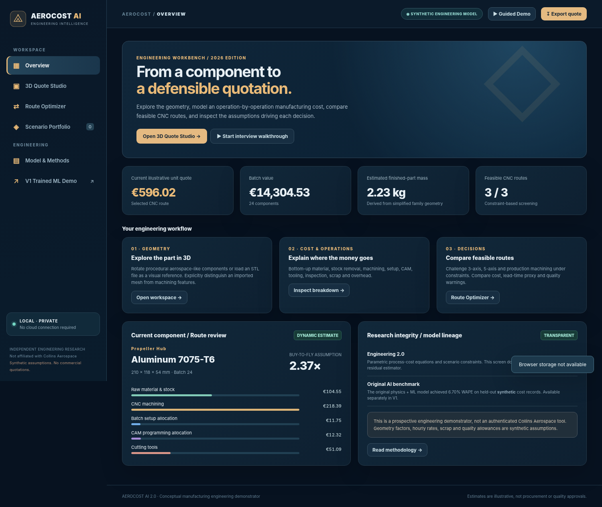
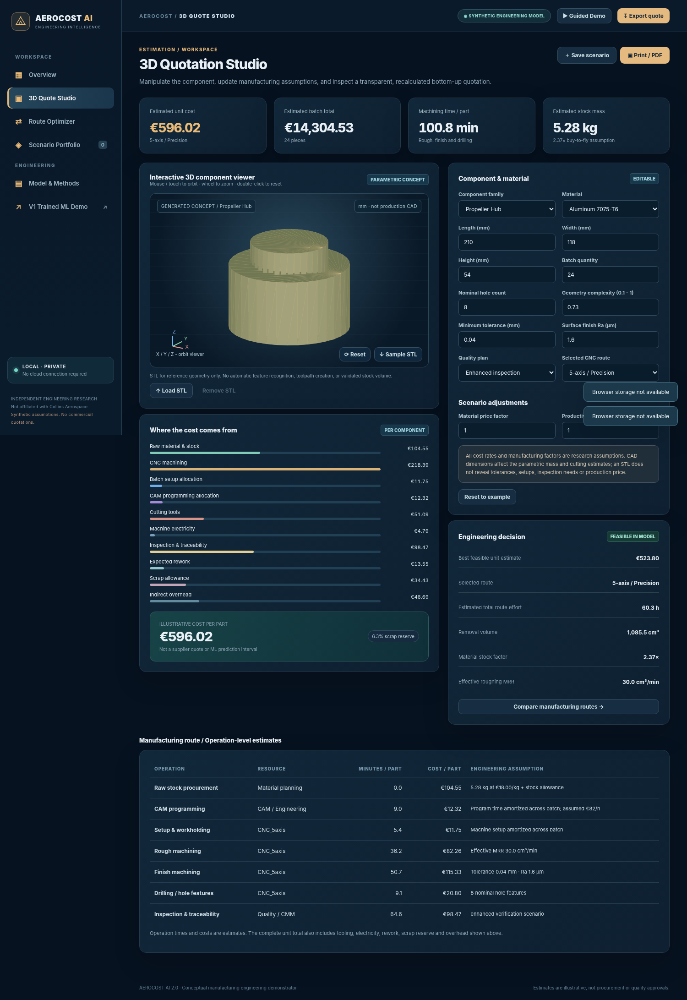
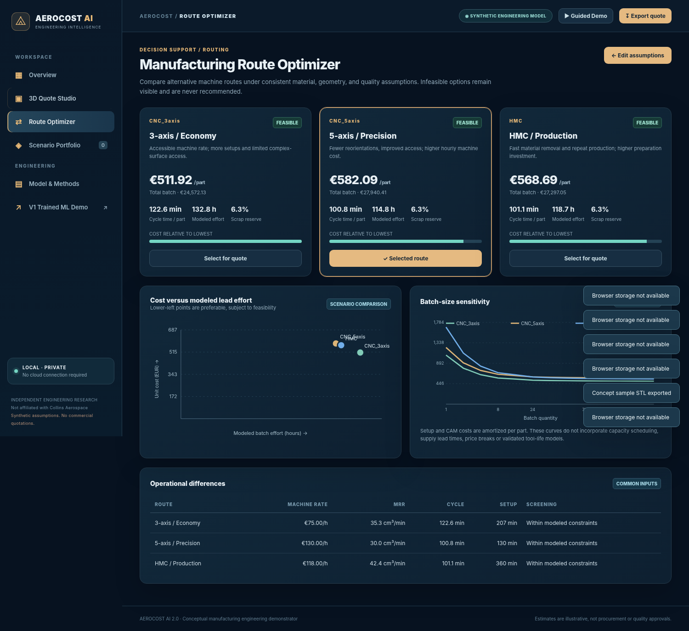

<div align="center">

# AEROCOST AI 2.0

### Aerospace Manufacturing Cost Estimation & 3D Quote Studio

**Build a machining quote, compare equipment routes, and see how batch size changes unit cost.**

**3D part viewer** · **Cost breakdown** · **Route comparison** · **Synthetic ML benchmark**

[Quick start](#quick-start) · [Studio preview](#studio-preview) · [Cost model](#cost-model-and-limits) · [Project layout](#project-layout)

</div>



> [!NOTE]
> AEROCOST AI is an independent educational prototype. All quotations, rates, production outcomes, and quality assumptions are synthetic or illustrative. The project has no affiliation with Collins Aerospace or Ratier-Figeac.

## Quick start

| Demo | What you can explore | Requirements |
| --- | --- | --- |
| **V2 · Engineering Studio** | Build a quote, inspect a conceptual 3D part, compare manufacturing routes, and export scenarios | A web browser |
| **V1 · Trained ML Demo** | Explore the original hybrid physics and machine learning model trained on synthetic quotations | Python 3 and the dataset ZIP |

### V2 · Open the offline studio

1. On GitHub, select **Code → Download ZIP** and extract the repository.
2. Open [`AEROCOST_AI_2_Offline_Demo.html`](AEROCOST_AI_2_Offline_Demo.html) in your browser.

The standalone V2 demo runs locally without Python, a server, or the dataset. You can also open `index.html` from the extracted project folder.

### V1 · Run the trained model

1. From the extracted project folder, unzip [`aerocost-data.zip`](aerocost-data.zip). Check that `data/quotations.csv` exists and that `data/` sits alongside `backend.py`.
2. Start the server from the project folder.
   - **Windows** · Double-click `RUN_WINDOWS.bat`. Python 3 must be on your `PATH`.
   - **Linux / Ubuntu** · Run `bash RUN_LINUX.sh`.
3. Open [http://127.0.0.1:8502](http://127.0.0.1:8502) and select **V1 Trained ML Demo** in the left menu.

## Studio preview

| 3D Quote Studio | Route Optimizer |
| --- | --- |
|  |  |
| Configure a part and inspect the estimated cost breakdown. | Compare three equipment routes under the same assumptions. |

## What you can do

| Feature | What it does |
| --- | --- |
| **3D Quote Studio** | Rotate and zoom conceptual hub, shaft, bracket, and housing models. Inspect local ASCII or binary STL files and optionally transfer their dimensions into a quote. |
| **Engineering cost breakdown** | See how material, machining time, tooling, setup, CAM, inspection, energy, rework, scrap, and overhead contribute to unit cost. |
| **Route Optimizer** | Compare three candidate equipment routes by estimated unit cost and production effort, with screening based on the selected inputs. |
| **Scenario Portfolio** | Name, save, and reload quote scenarios in browser storage. |
| **Exports** | Export a quote as JSON, a scenario portfolio as CSV, or a conceptual part as STL. Save a PDF through the browser’s print dialog. |
| **Guided Demo** | Follow the walkthrough from the app’s top navigation. |

## Cost model and limits

**V2** calculates an engineering estimate from illustrative inputs. It estimates material from modeled stock mass and a part-family buy-to-fly ratio, approximates machining time using a material removal rate proxy, and spreads setup and programming costs across the batch. The quote range shows how changes in material price and productivity affect the estimate. It has no statistical coverage guarantee.

**V1** uses a separate hybrid model that learns corrections to a physics-based baseline. It achieved **6.70% WAPE** on a held-out synthetic test set from the original 60,000-quotation dataset. That result applies only to V1 on that synthetic test set. V2 estimates come from the engineering cost model above.

STL import assumes millimetres because STL files do not encode units. The viewer supports dimensional inspection. Feature recognition, watertight volume calculation, toolpath generation, and production feasibility validation are outside its scope.

## Try a 24-piece quote

1. Open **Guided Demo → 3D Quote Studio**, select a **hub**, and set the batch size to **24**.
2. Increase the batch size and watch how setup and programming cost per part change.
3. Tighten the tolerance, then open **Route Optimizer** to see how the route screening responds.
4. Save both scenarios and export a JSON quote so you can compare the inputs and cost breakdowns.

## Reproduction checks

Run these from the project root. The browser smoke test requires Playwright and Chromium.

```bash
node --check assets/app-v2.js
node --check assets/engineering-v2.js
python tests/smoke_test.py
```

For the V1 API health check, start `python backend.py` after extracting the dataset, then open [http://127.0.0.1:8502/api/health](http://127.0.0.1:8502/api/health).

## Project layout

| Path | Contents |
| --- | --- |
| `AEROCOST_AI_2_Offline_Demo.html` | Standalone V2 workbench |
| `index.html`, `assets/` | V2 web interface and engineering cost calculations |
| `legacy/` | Original V1 interface with 120 precomputed offline cases and access to the trained model when the backend is running |
| `backend.py`, `models/` | Python API, saved V1 model, and evaluation files |
| `aerocost-data.zip` | Synthetic dataset archive. Extract it to create `data/` alongside `backend.py`. |
| `RUN_WINDOWS.bat`, `RUN_LINUX.sh` | Local launch scripts |
| `tests/` | Smoke tests |

## Further development

For industrial validation, calibrate the cost assumptions against authorized production records, compare estimates with actual job costs on held-out parts, and validate route feasibility using CAD/CAM and machine capability data.
